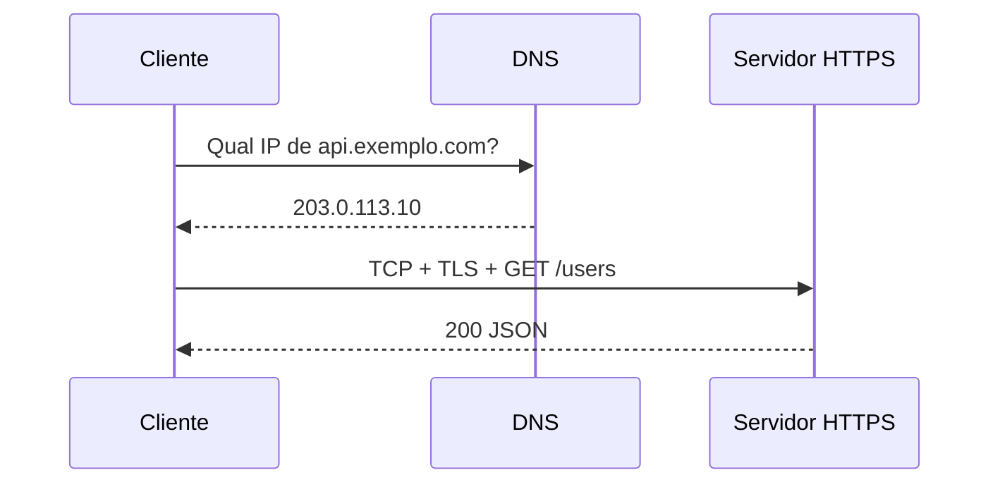

# APIs, REST e redes — nível avançado

Complemento do [API.md](API.md) (bases + FastAPI + organização de código). Aqui entram **redes**, **HTTP a fundo**, **REST de verdade**, **outros estilos de API**, **segurança**, **escala** e **o que estudar depois**.

**Ordem sugerida:** domine [API.md §1–8](API.md) antes de mergulhar aqui.

---

## Índice

1. [Como a internet chega na sua API (pilha de rede)](#1-como-a-internet-chega-na-sua-api-pilha-de-rede)
2. [TCP, UDP, portas e sockets (conceito)](#2-tcp-udp-portas-e-sockets-conceito)
3. [DNS, URLs e o que acontece antes do HTTP](#3-dns-urls-e-o-que-acontece-antes-do-http)
4. [TLS/HTTPS — criptografia na prática](#4-tlshttps--criptografia-na-prática)
5. [HTTP a fundo (1.1, 2, 3)](#5-http-a-fundo-11-2-3)
6. [Cabeçalhos HTTP que APIs sérias usam](#6-cabeçalhos-http-que-apis-sérias-usam)
7. [Cache, condicionais e performance HTTP](#7-cache-condicionais-e-performance-http)
8. [CORS, same-origin e cookies](#8-cors-same-origin-e-cookies)
9. [RESTful de verdade — além do CRUD](#9-restful-de-verdade--além-do-crud)
10. [Modelo de maturidade REST (Richardson)](#10-modelo-de-maturidade-rest-richardson)
11. [HATEOAS e hipermídia](#11-hateoas-e-hipermídia)
12. [Idempotência, segurança de métodos e transações](#12-idempotência-segurança-de-métodos-e-transações)
13. [Paginação, filtros, ordenação e contratos de lista](#13-paginação-filtros-ordenação-e-contratos-de-lista)
14. [Versionamento e evolução de API](#14-versionamento-e-evolução-de-api)
15. [Erros padronizados (Problem Details)](#15-erros-padronizados-problem-details)
16. [OpenAPI, contratos e documentação viva](#16-openapi-contratos-e-documentação-viva)
17. [Outros estilos: RPC, GraphQL, gRPC](#17-outros-estilos-rpc-graphql-grpc)
18. [Tempo real: WebSocket e SSE](#18-tempo-real-websocket-e-sse)
19. [Webhooks e integrações assíncronas](#19-webhooks-e-integrações-assíncronas)
20. [Autenticação avançada (OAuth2, OIDC, scopes)](#20-autenticação-avançada-oauth2-oidc-scopes)
21. [Segurança de APIs (OWASP API Top 10)](#21-segurança-de-apis-owasp-api-top-10)
22. [Observabilidade: logs, métricas, tracing](#22-observabilidade-logs-métricas-tracing)
23. [Escala: proxy, balanceador, gateway, filas](#23-escala-proxy-balanceador-gateway-filas)
24. [Padrões distribuídos (visão de arquiteto)](#24-padrões-distribuídos-visão-de-arquiteto)
25. [Mapa de estudo avançado + checklist](#25-mapa-de-estudo-avançado--checklist)

---

## 1. Como a internet chega na sua API (pilha de rede)

Você não precisa decorar o modelo OSI inteiro. Para backend, use este **mapa mental** (de baixo para cima):

```text
[Aplicação]     HTTP, JSON, sua lógica FastAPI
[Transporte]    TCP (confiável) ou UDP (rápido, sem garantia)
[Rede]          IP — endereços (ex.: 203.0.113.10)
[Enlace/Físico] Wi‑Fi, cabo, datacenter — “como os bits viajam”
```

Quando o cliente chama `https://api.exemplo.com/users`:

1. **DNS** resolve `api.exemplo.com` → IP.
2. **TCP** abre conexão na **porta** 443 (HTTPS).
3. **TLS** criptografa o canal.
4. **HTTP** envia `GET /users` com headers.
5. Seu **servidor** (Nginx → Uvicorn → FastAPI) processa e devolve resposta.



**O que aprender:** diferença entre **endereço IP**, **porta**, **hostname** e **path** (`/users`).

| Peça | Exemplo | Papel |
| ---- | ------- | ----- |
| Hostname | `api.exemplo.com` | Nome legível (DNS) |
| IP | `203.0.113.10` | Onde o pacote vai na rede |
| Porta | `443` (HTTPS), `8000` (dev) | Qual “serviço” na máquina |
| Path | `/v1/users/42` | Recurso dentro da API |

**Localhost:** `127.0.0.1` — tráfego que **não sai** da sua máquina. `0.0.0.0` no bind do servidor = aceitar conexões de qualquer interface (útil em Docker).

---

## 2. TCP, UDP, portas e sockets (conceito)

| Protocolo | Características | Uso típico |
| --------- | --------------- | ---------- |
| **TCP** | Ordem, retransmissão, conexão | HTTP, HTTPS, PostgreSQL, Redis |
| **UDP** | Sem conexão, pode perder pacotes | DNS, VoIP, alguns jogos, QUIC (base do HTTP/3) |

**Socket** = combinação IP + porta + protocolo. Sua API “escuta” um socket (ex.: `0.0.0.0:8000`).

Em Python (só para entender — em produção use Uvicorn/Gunicorn):

```python
# Conceito: servidor TCP mínimo (não é HTTP completo)
import socket

with socket.socket(socket.AF_INET, socket.SOCK_STREAM) as s:
    s.bind(("127.0.0.1", 9999))
    s.listen(1)
    conn, addr = s.accept()
    with conn:
        data = conn.recv(1024)
        conn.sendall(b"HTTP/1.1 200 OK\r\nContent-Length: 2\r\n\r\nOK")
```

HTTP **assume** TCP confiável. Por isso APIs REST quase sempre são HTTP(S) sobre TCP.

**Ferramentas para praticar:** `ping` (ICMP, não é porta), `nc`/`telnet`, `ss -tlnp` (portas abertas no Linux), `curl -v` (ver handshake HTTP/TLS).

---

## 3. DNS, URLs e o que acontece antes do HTTP

### 3.1 Anatomia de uma URL

```text
https://api.exemplo.com:443/v1/users?page=2&limit=10#detalhe
|----|   |----------------| |--| |--------| |-------------| |-------|
scheme      host          porta   path      query          fragment
```

- **Query string** (`?page=2`) — filtros/paginação (comuns em `GET`).
- **Fragment** (`#...`) — **não** vai para o servidor; é do browser.

### 3.2 DNS (simplificado)

1. Cliente pergunta: “qual IP de `api.exemplo.com`?”
2. Resposta: registro **A** (IPv4) ou **AAAA** (IPv6).
3. **CNAME** aponta um nome para outro (ex.: CDN).

Para deploy você vai ver: **A/AAAA**, **CNAME**, às vezes **TXT** (verificação, SPF para email).

### 3.3 Proxy reverso

O cliente fala com `https://api.exemplo.com`; por trás, Nginx encaminha para `http://127.0.0.1:8000` (seu Uvicorn). O cliente **não vê** a porta 8000.

---

## 4. TLS/HTTPS — criptografia na prática

**HTTP** = texto legível na rede. **HTTPS** = HTTP dentro de **TLS**.

| Conceito | O que significa para você |
| -------- | ------------------------- |
| **Certificado** | Prova que o servidor é quem diz ser (CA assina) |
| **Chave pública/privada** | Negociação segura sem enviar senha em claro |
| **TLS 1.2 / 1.3** | Versões modernas; desative SSL antigo em produção |
| **mTLS** | Cliente **também** apresenta certificado (B2B, mesh) |

Em desenvolvimento local, `http://127.0.0.1:8000` sem TLS é normal. Em produção, **sempre HTTPS** na borda (Let’s Encrypt, Cloudflare, load balancer).

**Não confunda:** TLS protege **transporte**. Ainda precisa de **auth** (JWT, OAuth) e **validação de input**.

---

## 5. HTTP a fundo (1.1, 2, 3)

### 5.1 Mensagem HTTP (request)

```http
GET /v1/users/42 HTTP/1.1
Host: api.exemplo.com
Accept: application/json
Authorization: Bearer eyJhbGciOi...
User-Agent: curl/8.5.0

(corpo vazio em GET)
```

### 5.2 Mensagem HTTP (response)

```http
HTTP/1.1 200 OK
Content-Type: application/json; charset=utf-8
Content-Length: 45
ETag: "v1-abc123"

{"id":42,"nome":"Ana"}
```

### 5.3 Versões

| Versão | Ideia | Impacto na API |
| ------ | ----- | -------------- |
| **HTTP/1.1** | Uma requisição por vez no mesmo TCP (sem pipelining na prática) | Padrão que você debuga com `curl` |
| **HTTP/2** | Multiplexação no mesmo TCP, headers comprimidos (HPACK) | Menos latência com muitos assets; APIs JSON se beneficiam menos que sites |
| **HTTP/3** | HTTP/2 sobre **QUIC** (UDP) | Melhor em redes instáveis; transparente para sua app na maioria dos casos |

**Para o desenvolvedor de API:** conheça **semântica** HTTP (métodos, status, headers). A versão costuma ser resolvida pelo proxy/CDN.

### 5.4 Métodos — propriedades formais

| Método | Safe? | Idempotente? | Nota |
| ------ | ----- | ------------ | ---- |
| GET | Sim | Sim | Só leitura; pode ser cacheado |
| HEAD | Sim | Sim | Como GET sem body |
| PUT | Não | Sim | Substituir recurso inteiro |
| DELETE | Não | Sim | Repetir DELETE → mesmo efeito lógico |
| POST | Não | **Não** | Criar / ação; repetir pode criar duplicata |
| PATCH | Não | Nem sempre | Atualização parcial |

**Safe:** não altera estado no servidor (na teoria). **Idempotente:** N chamadas iguais = mesmo efeito que 1.

---

## 6. Cabeçalhos HTTP que APIs sérias usam

| Header | Uso |
| ------ | --- |
| `Content-Type` | Tipo do body (`application/json`) |
| `Accept` | O que o cliente aceita na resposta |
| `Authorization` | Credencial (Bearer, Basic, etc.) |
| `Host` | Nome virtual (obrigatório em HTTP/1.1) |
| `User-Agent` | Quem é o cliente |
| `X-Request-ID` / `traceparent` | Rastrear pedido entre serviços |
| `Idempotency-Key` | POST seguro contra retry (pagamentos) |
| `Prefer: return=minimal` | Cliente quer resposta enxuta |
| `Link` | Paginação estilo RFC 5988 |

Exemplo FastAPI — header customizado:

```python
from fastapi import Header, Request

@app.get("/items")
def listar_items(x_request_id: str | None = Header(default=None)):
    # propague x_request_id nos logs
    return []
```

---

## 7. Cache, condicionais e performance HTTP

APIs **podem** ser cacheadas (CDN, gateway, cliente) se você for explícito.

| Header | Função |
| ------ | ------ |
| `Cache-Control` | `max-age`, `no-store`, `private` |
| `ETag` | “Versão” do recurso |
| `If-None-Match` | Cliente manda ETag; se igual → `304 Not Modified` |
| `Last-Modified` | Data da última alteração |
| `Vary` | Cache separado por `Accept-Language`, etc. |

```http
GET /products/5
If-None-Match: "v3-7f2a"

HTTP/1.1 304 Not Modified
```

**`no-store`:** dados sensíveis (perfil, token) — não cachear.  
**Listagens públicas** (`GET /products`): `ETag` + `Cache-Control` podem aliviar carga.

No Python, cache de **aplicação** (Redis) é outra camada — não substitui headers HTTP, complementa.

---

## 8. CORS, same-origin e cookies

### 8.1 Same-origin

Mesma origem = mesmo **scheme + host + porta**.

- Front `https://app.exemplo.com` chamando API `https://api.exemplo.com` → **origens diferentes** → browser aplica **CORS**.

### 8.2 CORS (Cross-Origin Resource Sharing)

O **browser** bloqueia JavaScript de ler resposta cross-origin **a menos** que a API envie headers permitindo.

Preflight (OPTIONS) para métodos/headers “não simples”:

```http
OPTIONS /users
Origin: https://app.exemplo.com
Access-Control-Request-Method: POST

HTTP/1.1 204
Access-Control-Allow-Origin: https://app.exemplo.com
Access-Control-Allow-Methods: GET, POST
Access-Control-Allow-Headers: Authorization, Content-Type
```

FastAPI:

```python
from fastapi.middleware.cors import CORSMiddleware

app.add_middleware(
    CORSMiddleware,
    allow_origins=["https://app.exemplo.com"],
    allow_credentials=True,
    allow_methods=["*"],
    allow_headers=["*"],
)
```

**Importante:** CORS é proteção do **browser**. `curl` e apps mobile **ignoram** CORS — segurança real é **auth + HTTPS**.

### 8.3 Cookies vs Bearer token

| | Cookie (sessão) | Bearer JWT |
|---|----------------|------------|
| Enviado por | Browser automaticamente | Header `Authorization` |
| CSRF | Risco em forms | Menor em SPA com header |
| Mobile | Menos comum | Muito comum |

---

## 9. RESTful de verdade — além do CRUD

**REST** (Representational State Transfer) é um **estilo arquitetural**, não um framework.

Princípios que costumam aparecer em APIs “RESTful”:

| Princípio | Na prática |
| --------- | ---------- |
| **Recursos** | URLs nomeiam coisas (`/orders`), não verbos (`/createOrder`) |
| **Representações** | JSON, XML, HTML — mesma entidade, formatos diferentes |
| **Stateless** | Servidor não guarda “sessão de navegação” entre requests; contexto vem em token/URL/body |
| **Uniform interface** | Métodos HTTP padrão, media types, URIs |
| **Camadas** | Cliente não sabe se fala com cache, gateway ou app |
| **Cacheável** | Respostas podem declarar se são cacheáveis |

**Sub-recursos** (decisão de design):

```text
GET /users/42/orders        # pedidos do usuário 42
GET /orders?user_id=42      # alternativa — às vezes melhor para listas grandes
```

Regra prática: aninhamento **1 nível** costuma ser ok; árvores profundas (`/a/b/c/d`) complicam permissões e cache.

**Ações que não são CRUD** (ex.: “cancelar pedido”):

- `POST /orders/42/cancel` (RPC-ish, mas claro), ou
- `PATCH /orders/42` com `{"status": "cancelled"}` (mais REST puro)

---

## 10. Modelo de maturidade REST (Richardson)

Leonard Richardson classificou APIs em níveis — útil para autocrítica:

| Nível | Nome | O que é |
| ----- | ---- | ------- |
| **0** | POX | Um endpoint, POST com “ação” no body |
| **1** | Recursos | URIs diferentes por recurso |
| **2** | HTTP verbs | GET/POST/PUT/DELETE com significado |
| **3** | Hipermídia | Respostas trazem **links** para próximos passos (HATEOAS) |

A maioria das APIs de mercado para em **nível 2** — e está bem. Nível 3 é raro exceto em APIs muito públicas/documentadas.

---

## 11. HATEOAS e hipermídia

**HATEOAS** = Hypermedia As The Engine Of Application State. O cliente descobre o que fazer pelos **links** na resposta, não por documentação fixa.

Exemplo (ilustrativo):

```json
{
  "id": 42,
  "status": "pending",
  "total": 99.9,
  "_links": {
    "self": { "href": "/orders/42" },
    "cancel": { "href": "/orders/42/cancel", "method": "POST" },
    "pay": { "href": "/orders/42/payments", "method": "POST" }
  }
}
```

Se `status` virar `paid`, a API pode **omitir** `cancel` e expor `refund`. O cliente segue links permitidos.

**Quando estudar:** integrações muito desacopladas. Para SPA + OpenAPI, links no JSON são opcionais.

---

## 12. Idempotência, segurança de métodos e transações

### 12.1 Retries e POST duplicado

Cliente mobile perde sinal e **reenvia** o mesmo POST → dois pedidos iguais.

**Solução:** header `Idempotency-Key: uuid` — servidor guarda resultado da primeira vez e devolve o mesmo nas repetições (janela de 24h, etc.).

```python
# Esboço de lógica (Redis ou tabela idempotency_keys)
def criar_pagamento(key: str, body: PaymentCreate):
    if cached := store.get(key):
        return cached
    result = processar(body)
    store.set(key, result, ttl=86400)
    return result
```

### 12.2 PUT vs PATCH

- **PUT:** cliente manda representação **completa**; campos omitidos podem virar `null`/default.
- **PATCH:** JSON Patch (`[{ "op": "replace", "path": "/email", "value": "..." }]`) ou merge parcial — documente qual você usa.

### 12.3 Transações e API

HTTP **não** tem transação distribuída nativa. Padrões:

- **Uma operação = um request** com transação no banco (local).
- **Saga / outbox** para vários serviços (avançado — ver [§24](#24-padrões-distribuídos-visão-de-arquiteto)).

---

## 13. Paginação, filtros, ordenação e contratos de lista

### 13.1 Offset/limit (simples)

```http
GET /items?offset=20&limit=10
```

Problema: em listas **muito grandes**, `OFFSET` fica lento no SQL.

### 13.2 Cursor (recomendado em escala)

```http
GET /items?cursor=eyJpZCI6MTAwfQ&limit=10
```

Resposta:

```json
{
  "data": [...],
  "next_cursor": "eyJpZCI6MTEwfQ",
  "has_more": true
}
```

Cursor = token opaco (não é obrigatório expor ID interno).

### 13.3 Ordenação e filtro

```http
GET /products?sort=-created_at,name&category=books&price_gte=10
```

Documente no OpenAPI. Valide whitelist de campos ordenáveis (evita SQL injection em `ORDER BY` dinâmico).

### 13.4 Header Link (alternativa)

```http
Link: <https://api.exemplo.com/items?cursor=abc>; rel="next"
```

---

## 14. Versionamento e evolução de API

| Estratégia | Exemplo | Prós / contras |
| ---------- | ------- | -------------- |
| URL | `/v1/users`, `/v2/users` | Explícito; URLs longas |
| Header | `Accept: application/vnd.exemplo.v2+json` | URL limpa; menos visível |
| Query | `/users?version=2` | Raro em APIs públicas |

**Mudança compatível (não quebra):** adicionar campo opcional, novo endpoint.  
**Quebra:** remover campo, mudar tipo, renomear.

Política comum: **deprecar** (`Sunset` header, aviso na doc) → manter v1 por N meses → desligar.

---

## 15. Erros padronizados (Problem Details)

RFC **7807** — corpo de erro consistente:

```json
{
  "type": "https://api.exemplo.com/errors/insufficient-funds",
  "title": "Saldo insuficiente",
  "status": 402,
  "detail": "Conta 42 não tem saldo para débito de 100.00",
  "instance": "/payments/req-9f3a"
}
```

`Content-Type: application/problem+json`

FastAPI permite `HTTPException(detail=...)`; para APIs públicas grandes, um handler global converte exceções de domínio para Problem Details.

---

## 16. OpenAPI, contratos e documentação viva

**OpenAPI 3** descreve paths, schemas, auth, exemplos. FastAPI gera em `/openapi.json` e UI em `/docs`.

| Abordagem | Fluxo |
| --------- | ----- |
| **Code-first** | Você escreve Pydantic + rotas → gera OpenAPI |
| **Contract-first** | Você escreve YAML OpenAPI → gera stubs/clientes |

Ferramentas: **Spectral** (lint do contrato), geradores de cliente (TypeScript, Kotlin).

**JSON Schema** (base do OpenAPI) — estude se integrar com validação fora do Python.

---

## 17. Outros estilos: RPC, GraphQL, gRPC

| Estilo | Transporte | Quando faz sentido |
| ------ | ---------- | ------------------ |
| **REST + JSON** | HTTP | CRUD, integrações públicas, simplicidade |
| **JSON-RPC** | HTTP POST um endpoint | Legado, procedimentos nomeados |
| **GraphQL** | HTTP POST `/graphql` | Cliente monta query; muitos recursos relacionados |
| **gRPC** | HTTP/2 + Protobuf | Microserviços internos, performance, streaming |
| **SOAP** | XML HTTP | Enterprise legado |

GraphQL exemplo (conceito):

```graphql
query {
  user(id: 42) {
    name
    orders(last: 5) { id total }
  }
}
```

Uma ida — evita overfetch/underfetch do REST com muitos endpoints. Custo: complexidade no servidor (N+1, cache, auth por campo).

gRPC em Python (`grpcio`) — contrato `.proto`:

```protobuf
service UserService {
  rpc GetUser (UserRequest) returns (User);
}
```

**Estude gRPC** quando REST virar gargalo **entre** seus próprios serviços, não no primeiro projeto.

---

## 18. Tempo real: WebSocket e SSE

| Tecnologia | Direção | Uso |
| ---------- | ------- | --- |
| **WebSocket** | Bidirecional | Chat, jogo, colaboração |
| **SSE** | Servidor → cliente | Notificações, feed de eventos simples |

FastAPI WebSocket (esboço):

```python
from fastapi import WebSocket

@app.websocket("/ws")
async def websocket_endpoint(ws: WebSocket):
    await ws.accept()
    await ws.send_text("conectado")
    msg = await ws.receive_text()
    await ws.close()
```

REST é **request/response**. Tempo real é **outro canal** — não tente “REST long-polling” sem necessidade.

---

## 19. Webhooks e integrações assíncronas

**Webhook:** sua API **chama** o cliente quando algo acontece.

```text
1. Cliente registra POST https://cliente.com/hooks com secret
2. Evento "pagamento.aprovado" ocorre
3. Seu servidor POST no URL do cliente com assinatura HMAC
```

Estude: **retry com backoff**, **assinatura** (`X-Signature-SHA256`), **idempotência** no receptor.

**Polling** (`GET /jobs/99` até `status=done`) é mais simples; webhook escala melhor para o cliente.

---

## 20. Autenticação avançada (OAuth2, OIDC, scopes)

### 20.1 OAuth2 (fluxos que importam)

| Fluxo | Quem | Uso |
| ----- | ---- | --- |
| **Authorization Code + PKCE** | App com usuário | Login social, SPA, mobile |
| **Client Credentials** | Máquina a máquina | Serviço chama sua API |
| **Refresh Token** | Renovar access token | Sessões longas sem relogar |

**OAuth2** = autorização (“pode acessar meus dados no Google”).  
**OpenID Connect (OIDC)** = camada de **identidade** (JWT com `sub`, perfil).

### 20.2 Scopes e RBAC

```text
scope: orders:read orders:write
role: admin → todas as permissões
```

No FastAPI: `Depends()` verificando scopes/roles após validar JWT.

### 20.3 API Keys

Header `X-API-Key` — simples para scripts; rotacione e rate-limite.

---

## 21. Segurança de APIs (OWASP API Top 10)

Estude a lista [OWASP API Security Top 10](https://owasp.org/www-project-api-security/) (versão atual). Resumo do que cai em prova e em produção:

| Risco | Mitigação |
| ----- | --------- |
| Broken Object Level Authorization | Checar `user_id` do token vs recurso (`/users/99` só se for 99 ou admin) |
| Broken Authentication | JWT curto, refresh seguro, não logar tokens |
| Excessive Data Exposure | `response_model` — não vazar campos internos |
| Lack of rate limiting | Por IP, por API key, por usuário |
| SQL/NoSQL injection | ORM parametrizado |
| Mass assignment | Schemas separados create vs update |
| Misconfiguration | CORS `*`, debug em prod, headers de segurança |

Headers úteis (muitos no reverse proxy): `Strict-Transport-Security`, `X-Content-Type-Options`, `Content-Security-Policy` (mais front).

---

## 22. Observabilidade: logs, métricas, tracing

| Pilar | O que é | Ferramentas (exemplos) |
| ----- | ------- | ---------------------- |
| **Logs** | Linhas estruturadas por request | `logging`, Loki, CloudWatch |
| **Métricas** | Contadores, latência p95 | Prometheus, Grafana |
| **Tracing** | Árvore de spans entre serviços | OpenTelemetry, Jaeger |

**Correlation ID:** propague `X-Request-ID` do gateway até o banco.

```python
import logging
import uuid
from contextvars import ContextVar

request_id_var: ContextVar[str] = ContextVar("request_id", default="-")

class RequestIdFilter(logging.Filter):
    def filter(self, record):
        record.request_id = request_id_var.get()
        return True
```

Health checks:

- **`/health/live`** — processo vivo?
- **`/health/ready`** — consegue falar com banco?

---

## 23. Escala: proxy, balanceador, gateway, filas

```text
Internet → CDN → Load Balancer → API Gateway → [App1, App2, App3] → DB
                                      ↓
                                   Redis cache
                                      ↓
                                   Fila (RabbitMQ, SQS, Redis)
```

| Componente | Função |
| ------------ | ------ |
| **Reverse proxy** (Nginx, Caddy) | TLS, compressão, rate limit |
| **Load balancer** | Distribuir tráfego, health check |
| **API Gateway** | Auth centralizada, roteamento, throttling (Kong, AWS API GW) |
| **Fila** | Trabalho pesado fora do request (email, PDF, ML) |

Padrão **async:** `POST /reports` → `202 Accepted` + `{ "job_id": "..." }` → cliente consulta `GET /jobs/{id}` ou recebe webhook.

---

## 24. Padrões distribuídos (visão de arquiteto)

Não implemente tudo no primeiro projeto — **reconheça os nomes**:

| Padrão | Ideia |
| ------ | ----- |
| **Circuit breaker** | Parar de chamar serviço que está fora |
| **Retry + exponential backoff** | Re tentar com espera crescente |
| **Bulkhead** | Isolar falha (pool separado) |
| **Saga** | Transação em vários serviços com compensação |
| **Outbox** | Gravar evento no DB e publicar de forma confiável |
| **CQRS** | Separar modelo de leitura e escrita |
| **BFF** | Backend for Frontend — API moldada para um app |

**CAP theorem (intuição):** em partição de rede, você escolhe entre consistência forte e disponibilidade — relevante para DB distribuído, não para CRUD simples em SQLite.

---

## 25. Mapa de estudo avançado + checklist

### Ordem sugerida (após API.md)

1. Pilha TCP/IP + DNS + `curl -v`  
2. HTTPS e certificados (deploy real uma vez)  
3. HTTP: cache, ETag, métodos idempotentes  
4. CORS e diferença browser vs `curl`  
5. REST nível 2 sólido + paginação cursor  
6. OpenAPI + Problem Details  
7. OAuth2/OIDC (um provedor de teste)  
8. Redis (cache + rate limit)  
9. Uma fila (processar job assíncrono)  
10. OpenTelemetry em um endpoint  
11. Ler OWASP API Top 10 e auditar sua API  
12. Comparar: quando GraphQL ou gRPC faria sentido  

### Checklist — redes e protocolos

- [ ] Explicar diferença entre IP, porta, URL path  
- [ ] Ler request/response HTTP cru com `curl -v`  
- [ ] Saber o que TLS adiciona em relação a HTTP  
- [ ] Diferenciar TCP e UDP em uma frase  
- [ ] Saber o que DNS resolve  

### Checklist — REST e HTTP avançado

- [ ] Classificar sua API no modelo de Richardson  
- [ ] Explicar idempotência de PUT vs POST  
- [ ] Implementar paginação (offset ou cursor)  
- [ ] Definir política de versionamento  
- [ ] Usar `ETag` ou `Cache-Control` em um GET público  
- [ ] Configurar CORS conscientemente (não só `*`)  

### Checklist — produção e arquitetura

- [ ] `X-Request-ID` nos logs  
- [ ] `/health/ready` com checagem de DB  
- [ ] Rate limiting em rota sensível  
- [ ] Idempotency-Key em POST crítico  
- [ ] Webhook com assinatura HMAC (exercício)  
- [ ] Um job assíncrono com fila ou background task  

### Checklist — outros estilos

- [ ] Ler um schema GraphQL e comparar com REST  
- [ ] Ver um arquivo `.proto` gRPC  
- [ ] Conectar WebSocket ou SSE em exemplo mínimo  

---

## Referências (aprofundar)

| Tema | Onde |
| ---- | ---- |
| HTTP | RFC 9110 (semântica), MDN HTTP |
| REST | Dissertação de Roy Fielding; artigos sobre Richardson levels |
| TLS | Mozilla SSL Configuration Generator |
| OAuth2/OIDC | OAuth.net, documentação do provedor (Auth0, Keycloak) |
| OpenAPI | spec.openapis.org |
| OWASP | API Security Top 10 |
| Redes | “Computer Networking: a Top-Down Approach” (Kurose) — capítulos HTTP/DNS/TCP |
| Python async I/O | [README §20](README.md#20-concorrência-threads-processos-async) |

---

**Voltar ao básico prático:** [API.md](API.md) · **Trilha geral:** [ESTUDO.md](ESTUDO.md)
